# LotusLearn AI

> **Turn real student work into a verifiable next-lesson plan.**  
> *Privacy before inference. Evidence behind every insight. Teacher in control.*

---

## 1. Why LotusLearn Exists

Teachers already possess the evidence they need: handwritten worksheets, exit tickets, and written responses collected at the end of class.

However, synthesizing 30–45 individual student artifacts to identify root learning misconceptions takes 1.5 to 2 hours of manual diagnostic effort after a full day of teaching. By the time errors are manually categorized, the opportune instructional window for timely intervention has passed.

**The Solution:** LotusLearn bridges the gap between **assessment → interpretation → next teaching action**, transforming messy student artifacts into an evidence-verifiable, differentiated 25-minute lesson sequence.

---

## 2. What Makes LotusLearn Different

- **Artifact-First & Paper-Friendly:** Works directly from student artifacts teachers already have — typed text or photographed handwritten worksheets.
- **Privacy Before Inference:** All student names, emails, and phone numbers are de-identified via Google Cloud Sensitive Data Protection before content ever reaches Gemini.
- **Evidence-Verifiable Insights:** Every diagnosed misconception is directly anchored to verbatim student quotations and pedagogical grounding reasons.
- **Hybrid Verification:** Combines Gemini generative reasoning with deterministic programmatic validation code that checks roster math, student identities, and quotation presence.
- **Teacher Sovereignty (Human-in-the-Loop):** AI recommends; teachers decide. Educators can Accept, Edit, or Dismiss any diagnosed cluster or intervention scaffold.
- **Non-Stigmatizing Cohorts:** Replaces permanent ability labels with temporary, action-oriented cohorts (*Ready for Extension*, *Needs Concept Clarification*, *Guided Practice*).

---

## 3. Architecture & Analysis Pipeline

LotusLearn operates as a synchronized 6-stage pipeline:

```mermaid
flowchart LR
    A[Student Artifacts] --> B[Privacy Gateway]
    B --> C[Sanitized Artifacts]
    C --> D[Gemini Observer]
    D --> E[Gemini Diagnosis]
    E --> F[Deterministic Validator]
    F --> G[Teaching Strategist]
    G --> H[Gemini Verifier]
    H --> I[Teacher Review]
    I --> J[Next-Lesson Plan]
```



### The 6 Stages:

1. **Protect (Stage 1 · Privacy Gateway):** Google Cloud Sensitive Data Protection (REST v2) strips student PII and normalizes roster keys to stable pseudonyms (`Student 01` – `Student 12`). Operates on a fail-closed basis.
2. **Observe (Stage 2 · Gemini Observer):** Gemini 3.8 Flash extracts structured student observations, benchmarking each against the lesson rubric and anchoring verbatim quotes without premature labeling.
3. **Diagnose (Stage 3 · Gemini Diagnosis):** Cross-reasons across the whole cohort to synthesize collective misconception patterns, affected student counts, and instructional priorities.
4. **Validate (Stage 4 · Deterministic Code Validator):** Independent programmatic code audits roster arithmetic, group partitioning, and validates verbatim quotation presence against raw submissions to prevent hallucinated citations.
5. **Plan (Stage 5 · Gemini Teaching Strategist):** Produces a differentiated 25-minute next-lesson sequence, non-stigmatizing cohorts, teacher prompts, and exit tickets.
6. **Verify (Stage 6 · Gemini Semantic Verifier & Teacher Authority):** Independent semantic audit evaluates claim plausibility. Teacher retains sovereign decision authority (Accept, Edit, Dismiss).

---

## 4. Google Technologies Used

- **Gemini 3.8 Flash (`@google/genai` v2.4.0):** Multi-stage reasoning engine for structured observations, diagnostic pattern clustering, and instructional planning.
- **Google Cloud Sensitive Data Protection (Cloud DLP REST v2):** Pre-AI PII de-identification (`content:deidentify` and `image:redact`) ensuring sensitive student data never reaches model boundaries.
- **Google Cloud Run:** Serverless container execution with automated scaling and sub-second latency.

---

## 5. Privacy & Data Governance Model

- **Fail-Closed Privacy Contract:** If the privacy provider encounters a network timeout, quota exhaustion, or outage, the pipeline aborts immediately. Zero un-sanitized content reaches Gemini.
- **Zero Raw PII Persistence:** Privacy audit metadata stores finding counts only, never raw sensitive values.
- **Zero PII in Server Logs:** Console and operational logs record stage durations, error taxonomy, and submission counts only.
- **Local Device Storage:** Saved session records reside in browser local storage. Data is never synchronized to unauthorized third-party trackers.

---

## 6. One-Click Interactive Demo

LotusLearn includes an interactive one-click demonstration using an authentic Grade 10 English classroom scenario (Unit: *Present Perfect vs. Past Simple* with contextual references to Hội An, Đà Nẵng, Huế, and Hạ Long):

1. Click **Try Demo Class** in the top navigation or sidebar.
2. The system executes the full 6-stage pipeline across 12 authentic student submissions.
3. Inspect diagnosed misconception clusters, click **Why?** to examine anchored evidence quotes, and review tomorrow's 25-minute lesson plan.

---

## 7. Local Development & Setup

### Prerequisites
- Node.js 20+
- npm 10+
- Google Gemini API Key

### Installation

```bash
# Clone the repository
git clone <repo-url>
cd lotuslearn-ai

# Install dependencies
npm install

# Configure environment variables
cp .env.example .env
# Add your GEMINI_API_KEY in .env

# Start development server
npm run dev
```

Visit `http://localhost:3000` in your browser.

---

## 8. Test Suite & Verification

LotusLearn maintains a comprehensive regression and validation test suite:

```bash
# Run TypeScript typecheck
npm run typecheck

# Run 181 automated tests (39 suites)
npm test

# Run ESLint validation
npm run lint

# Production build
npm run build
```

**Quality Baseline:**
- 181 / 181 Tests Pass (39 suites, 0 failures, 0 skips)
- TypeScript strict typecheck: Pass
- Canonical Demo SHA-256 Fingerprint: `f82100e176cd233e0b65efbf00fc7b8947e7dab66aadff9389f1f25f128bf1ce`

---

## 9. Current Limitations & Roadmap

- **Current Scope:** Optimized for English Language Arts, reading comprehension, and structured concept diagnostics.
- **Handwritten OCR:** Multi-page handwriting currently relies on high-resolution image uploads (`image/jpeg`, `image/png`).
- **Roadmap:**
  - Multi-class longitudinal progress tracking.
  - Multi-rubric simultaneous evaluation.
  - Direct LMS export integrations (Google Classroom).
